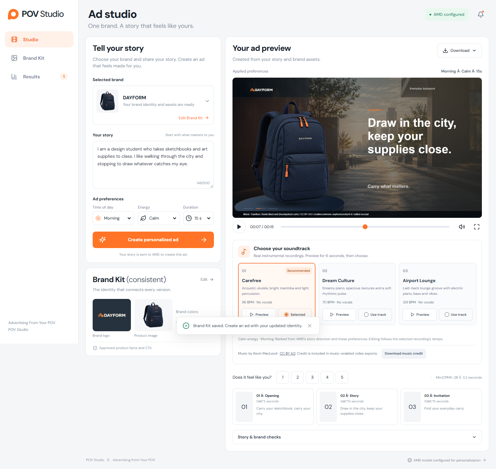
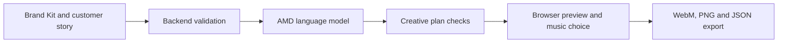

<p align="center">
  
</p>

# POV Studio

### Advertising From Your POV

**Turn a personal story into a motion ad that still belongs to the brand.**

POV Studio combines an approved Brand Kit with a customer's story to create a personalized, three-scene advertisement. An AMD-hosted language model writes the creative plan. The browser brings uploaded product photos, brand colors, transitions and a chosen instrumental soundtrack together in an exportable 2D video.

Built for the **AMD Developer Hackathon: ACT III**.

**[Open the live app](https://povstudioapp.netlify.app/)** · [Quick start](#quick-start) · [AMD integration](#amd-integration) · [Deploy to Netlify](#deploy-to-netlify)

## Why POV Studio?

A backpack can carry a design student's sketchbooks or an evening player's training gear. The product stays the same, but the reason it matters changes.

POV Studio makes that personal context part of the creative process. A brand supplies its identity and approved product information. A customer describes a moment from their life. The application uses both to create a relevant message while keeping the brand's assets and approved facts consistent.

The intended users are small brands, creators and agencies producing variations of a campaign. The goal is to reduce creative effort and improve relevance. Commercial uplift has not yet been measured.

## A look inside



*The screenshot uses the fictional DAYFORM test brand. The cover is illustrative artwork. New installations start with an empty Brand Kit and no preset stories or ads.*

## What you can do

| Capability | How it works |
| --- | --- |
| **Build a Brand Kit** | Add approved facts, product details, price, CTA and colors. Upload a logo, product photo and background. |
| **Personalize the message** | Describe a real moment or routine. AMD creates a hook and three scenes grounded in that story. |
| **Set creative preferences** | Choose Morning, Afternoon or Evening, Calm, Energetic or Bold energy, and a 10, 15 or 20-second duration. |
| **Preview motion editing** | Watch photo animation, perspective effects, transitions and editing timed to the selected soundtrack. |
| **Choose the music** | Audition three recommended instrumental recordings for six seconds each, then select the track used in the ad. |
| **Export and compare** | Download a 1280 × 720 WebM video, a PNG frame or the plan and metrics JSON. Save up to 12 ads in the current browser and rate relevance from 1 to 5. |

The current renderer animates uploaded photographs in **2D**. It does not generate new footage or reconstruct a 3D product. Preview and video export use the same canvas renderer and selected recording.

## How it works

1. **Prepare the brand.** Open **Brand Kit**, enter approved product information and upload optional PNG, JPEG or WebP assets, up to 650 KB each.
2. **Tell a story.** Describe the customer's context and choose the creative preferences.
3. **Generate the plan.** The backend calls AMD and validates the response before displaying the ad.
4. **Review the result.** Check the message, audition the recommended music and select a soundtrack.
5. **Export.** Download the video, image or creative plan. Keep the music attribution when sharing a video with music.

Editing the story or preferences creates an unapplied draft. Click **Create updated ad** to generate a new version. Saved ads keep the inputs used to create them.

## AMD integration

AMD powers the creative planning step through an OpenAI-compatible chat completions API. The model is configured on the backend through `AMD_MODEL`.

| Layer | Responsibility |
| --- | --- |
| **AMD API** | Personalized headline, supporting copy, three scene texts, a story quotation, an explanation and music direction with recording recommendations. |
| **Backend** | Server-only credentials, input validation, brand checks, one repair attempt for an invalid plan, response time and token usage. |
| **Browser** | Canvas 2D rendering, animation, soundtrack playback, local history and WebM recording. |



The backend requires exactly three scenes and an exact quotation from the customer's story. It checks field limits, brand constants and unsupported numeric claims. Invalid plans receive one repair attempt. Failed requests show an error instead of a fabricated ad.

These checks help reduce mistakes. Review the creative before publishing. The relevance rating is subjective feedback, not evidence of increased sales.

## Quick start

### Requirements

- **Node.js 22.12 or newer** and npm.
- An AMD API endpoint, model ID and API key with available quota.
- Chrome or Edge recommended for WebM export.

### 1. Install dependencies

Open a terminal in the repository root:

```sh
npm ci
```

### 2. Configure AMD

Copy `.env.example` to `.env`.

**PowerShell:**

```powershell
Copy-Item .env.example .env
```

**macOS / Linux:**

```sh
cp .env.example .env
```

Fill in the values supplied by your AMD account:

```dotenv
AMD_BASE_URL=your_amd_base_url
AMD_API_KEY=your_amd_api_key
AMD_MODEL=your_model_id
PORT=4173
```

The base URL must exclude `/chat/completions`. Keep `.env` private. The supplied `.gitignore` excludes it. API keys belong on the backend and must never use a `VITE_` prefix.

### 3. Run the application

```sh
npm run dev
```

Open **http://127.0.0.1:5173**. The local Express API runs on port **4173**. The app starts empty so you can supply your own brand and assets.

### Configuration reference

| Variable | Required | Purpose |
| --- | --- | --- |
| `AMD_BASE_URL` | Yes | AMD-compatible API base URL. |
| `AMD_API_KEY` | Yes | Credential used only by the backend. |
| `AMD_MODEL` | Yes | Exact model ID available to your account. |
| `AMD_TIMEOUT_MS` | No | Express timeout per attempt, default 120 seconds, bounded to 10–180 seconds. Netlify caps attempts at 25 seconds. |
| `AMD_INPUT_PRICE_PER_MILLION` | No | Verified input token price in USD. Leave blank when unknown. |
| `AMD_OUTPUT_PRICE_PER_MILLION` | No | Verified output token price in USD. Leave blank when unknown. |
| `PORT` | No | Local or standalone API port, default `4173`. Omit from Netlify. |
| `HOST` | No | Standalone listen address, default `127.0.0.1`. |
| `APP_ORIGIN` | No | Exact public origin for a standalone deployment or an additional allowed origin on Netlify. |

Unknown prices remain unavailable. Usage and rate limits depend on the AMD account.

## Deploy to Netlify

The repository includes [`netlify.toml`](netlify.toml) and a native [API function](netlify/functions/api.mjs). A repository deployment builds both the frontend and backend.

1. Connect the repository to Netlify.
2. Use **`npm run build`** as the build command and **`dist`** as the publish directory. The root configuration sets the functions directory to **`netlify/functions`**.
3. Add `AMD_BASE_URL`, `AMD_API_KEY` and `AMD_MODEL` in **Project configuration → Environment variables**, with **Functions** scope for the intended deploy context.
4. Mark `AMD_API_KEY` as a secret. The endpoint and model ID are public configuration. Omit `PORT` from Netlify to avoid treating the local port as a secret.
5. Deploy the latest commit, then open `/api/status`. A response containing `"configured": true` confirms that the backend can read its configuration. It does not verify an AMD inference request.

The function's custom `/api/*` route handles `/api/status` and `/api/generate`. Uploading only the `dist` folder does not deploy this backend. Requests from the deployed site's own origin are accepted automatically.

Netlify has a 60-second synchronous function limit. The adapter allows up to two AMD attempts of 25 seconds each. Slow requests can still time out. A longer-running Express deployment can use the separate timeout setting above.

See the official documentation for [Netlify Functions](https://docs.netlify.com/build/functions/overview/), [execution limits](https://docs.netlify.com/build/functions/configuration/) and [runtime environment variables](https://docs.netlify.com/build/functions/environment-variables/).

## Development and production

| Command | Purpose |
| --- | --- |
| `npm run dev` | Start Vite and the local Express API. |
| `npm test` | Run the Node.js regression suite. |
| `npm run build` | Build the frontend into `dist`. |
| `npm start` | Serve the production frontend and API through Express after building. |

Tests cover input and plan validation, AMD response repair, music selection, motion rendering, recording failure handling and the Netlify API adapter. See [implementation details](docs/IMPLEMENTATION.md) for renderer behavior, saved-ad compatibility and Docker instructions.

```text
src/
  components/          Studio, Brand Kit and ad preview interface
  lib/                 Validation, rendering, motion and music logic
server/                Local Express server and AMD provider
netlify/functions/     Deployed API adapter
public/music/          Instrumental recordings and attribution
tests/                 Regression tests
docs/                  Project images and implementation notes
```

## Music attribution

The application bundles excerpts of **Carefree**, **Dream Culture**, **Airport Lounge**, **Cipher** and **Wallpaper** by **Kevin MacLeod (incompetech.com)** under **[CC BY 4.0](https://creativecommons.org/licenses/by/4.0/)**.

AMD recommends recordings from this catalog. It does not generate the audio. Users choose the final track. Music-enabled exports include attribution, which must be kept when sharing. The interface also provides a downloadable credit.

Sources, excerpt offsets and audio modifications are documented in [CREDITS.txt](public/music/CREDITS.txt) and [provenance.json](public/music/provenance.json).

## Data and current limitations

- Generation requests pass through the backend. The AMD prompt contains the story and brand text. Uploaded image data is excluded from that prompt.
- Brand assets and up to 12 saved ads are stored in the current browser. There is no account synchronization. Export anything you need before clearing browser data.
- The music library contains five recordings, so recommendations can overlap between stories.
- Video export records the browser canvas. Keep the tab active. Actual frame rate and audio encoding depend on the browser and device.
- The request concurrency guard applies per server or function instance. It is not a global quota across Netlify instances.
- Commercial results remain unmeasured. A pilot should compare time to an approved ad, perceived relevance and brand consistency before testing campaign outcomes.
